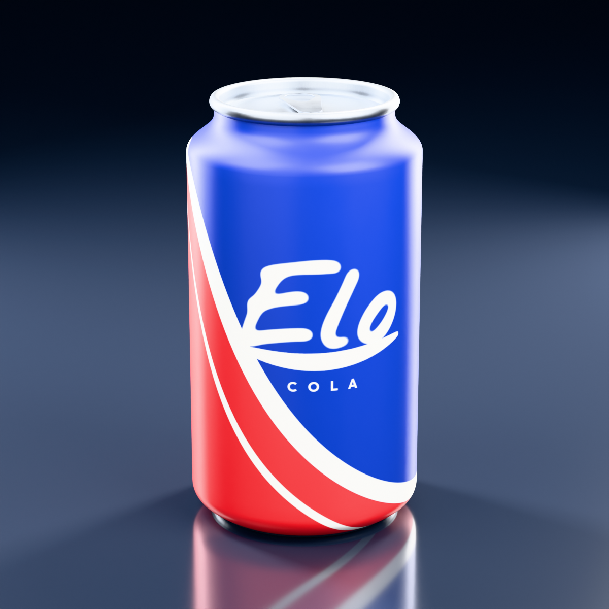
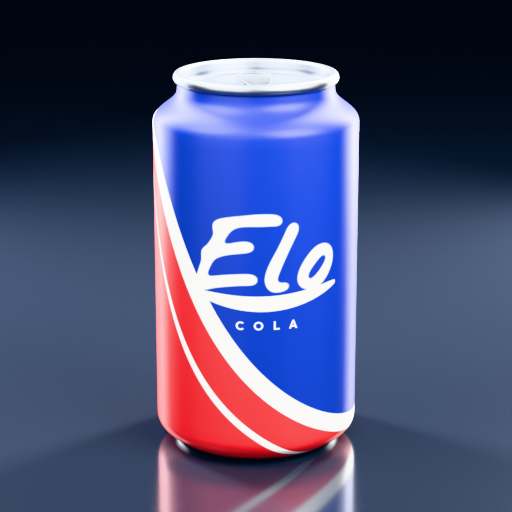
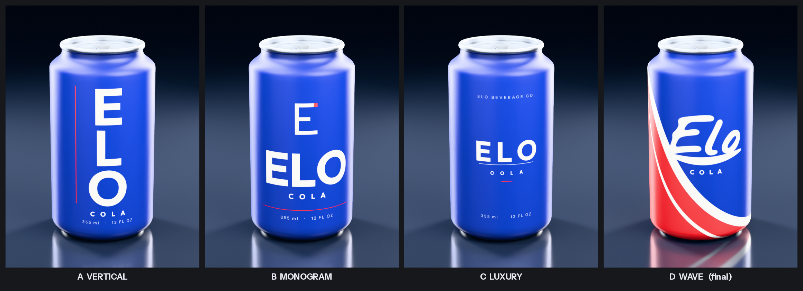
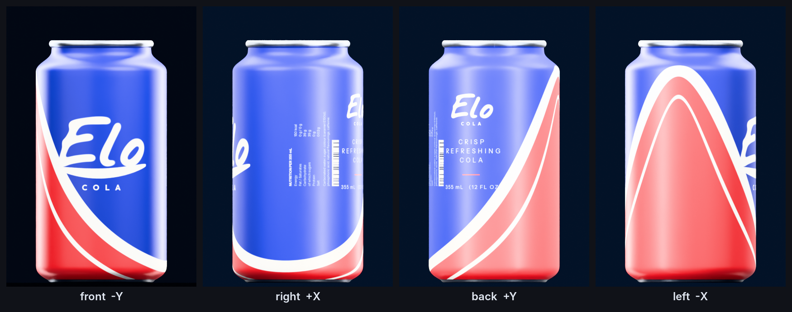
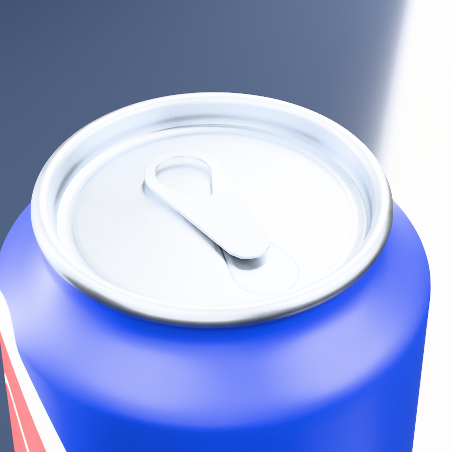
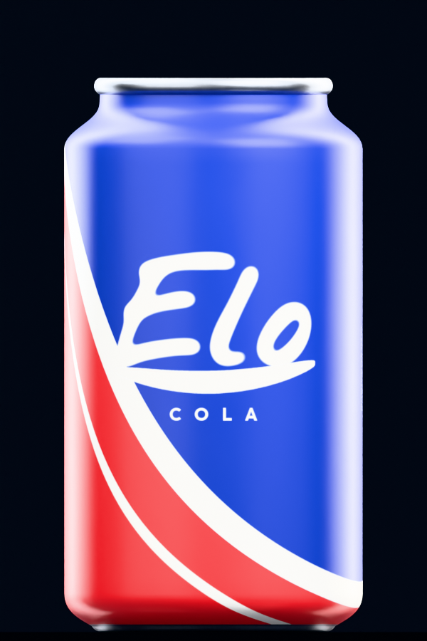

<h1 align="center">Elo Cola &mdash; Photorealistic 3D Can</h1>

<p align="center">
  
</p>

<p align="center">
  <em>A production-ready, fully procedural aluminium beverage can &mdash; one mesh, one texture, watertight.</em>
</p>

<p align="center">
  
  
  
  
</p>

---

## What this is

**Elo Cola** is an original, fictional cola brand created for this project. The model is a
standard **12 fl oz / 355 ml** aluminium beverage can &mdash; the familiar necked-in, double-seamed
can &mdash; generated entirely from Python, with no manual modelling and no third-party assets.

Everything here is produced by the scripts in [`scripts/`](scripts): the barrel is a lathed
Bezier profile, the drinking aperture and rivet are stamped into the lid by a signed distance
field, the pull tab is a closed genus-1 shell, and the whole 2048&times;2048 texture atlas is
painted with Pillow.

> **Trademark note.** The brief asked for a Pepsi-style can under the name *Elo Cola*. No Pepsi
> (or other beverage) name, logo, symbol, typeface or label composition is used anywhere in this
> repository. The identity below is original. Type is set in
> [Outfit](https://fonts.google.com/specimen/Outfit),
> [Instrument Sans](https://fonts.google.com/specimen/Instrument+Sans) and
> [Nothing You Could Do](https://fonts.google.com/specimen/Nothing+You+Could+Do), all SIL Open
> Font License, vendored with their licences in [`scripts/fonts/`](scripts/fonts).

---

## The five deliverables

| # | File | Size | What it is |
|---|------|------|-----------|
| 1 | [`assets/elo_cola.obj`](assets/elo_cola.obj) | 2.8 MB | Geometry &mdash; exported with `global_scale = 0.01` |
| 2 | [`assets/elo_cola.mtl`](assets/elo_cola.mtl) | 275 B | Material, references the single PNG via `map_Kd` |
| 3 | [`assets/elo_cola_texture.png`](assets/elo_cola_texture.png) | 1.8 MB | The one and only UV texture, 2048 &times; 2048 |
| 4 | [`assets/elo_cola.blend`](assets/elo_cola.blend) | 2.1 MB | Native project &mdash; texture packed, studio set-up saved |
| 5 | [`renders/elo_cola_product_512.png`](renders/elo_cola_product_512.png) | ~290 KB | Final product image, exactly 512 &times; 512 |

<p align="center">
  
  <br><sub>The mandatory 512 &times; 512 deliverable &mdash; Cycles, 480 samples</sub>
</p>

---

## Design

Four label directions were built and rendered on the real geometry before one
was chosen.

The research behind the first three: Pepsi's 2023 identity, whose own designers
describe **contrast** rather than ornament as the thing that made it work; and
the current minimalist end of the category &mdash; Studio Uzi's **Nokta** (heavy
type running vertically on matte metal), **United Sodas** (a single flat colour
plus white type and nothing else), and **Golden** (clean vertical structure).
Matte finishes recur across all of them as the premium cue.

The client then supplied a visual reference &mdash; a deep blue can crossed by a
sweeping red-and-white wave under a script logotype &mdash; and direction **D**
was built to match it. D is the shipped design.

<p align="center">
  
</p>

| | Direction | Verdict |
|---|---|---|
| A | Vertical &mdash; oversized stacked letters, one red rule | Most original of the first three; type does all the work |
| B | Monogram &mdash; original "E" mark over a bold wordmark | Clearest hierarchy, but a conventional lockup |
| C | Luxury &mdash; small wordmark adrift in negative space | Elegant, but too quiet to read at shelf distance |
| **D** | **Wave** &mdash; sweeping stroke, brush-script logotype | **Shipped**, to the client's supplied reference |

All four remain in the repository and can be re-rendered with
`python3 scripts/concept_preview.py`; pick one for the asset with
`generate_texture.py --concept A|B|C|D`.

**The shipped system**

| | |
|---|---|
| Field | deep cobalt `#092D8F` |
| Wave | one white stroke `#F7F5F0` with a thin companion, red `#D31C22` beyond |
| Logotype | "Elo" &mdash; a brush script grown to display weight |
| Supporting | "COLA" in Outfit Bold; rear copy in Instrument Sans |
| Metal | brushed aluminium lid, rim, tab and base |

**How the wave is built.** The boundary between cobalt and red is a single-cycle
sinusoid in `u`, so it closes seamlessly at the `u = 0 / u = 1` texture seam. It
is then pushed toward its low side by a M&ouml;bius warp,
`s = (f + b) / (1 + b·f)`, which is smooth everywhere &mdash; a gamma curve put a
visible cusp at the trough &mdash; and holds the boundary low around most of the
barrel, so cobalt dominates and red is concentrated into one flank. The white
stroke's *vertical* thickness is scaled by `sqrt(1 + slope²)` so its width
measured perpendicular to the curve stays constant, which is what makes it read
as a drawn stroke rather than a squashed stripe.

**The logotype.** Set in Nothing You Could Do, a light brush script, then grown
to display weight by blurring the glyph coverage and re-ramping it &mdash; which
thickens the strokes while keeping the terminals round, and preserves the
script's own rhythm better than a morphological dilate. The underswash beneath
it is a tapered stroke drawn from scratch. The lockup occupies 82&deg; of arc,
the proportion a real can logotype takes up, so it never runs off the
silhouette.

> **On trade dress.** A red-white-and-blue sweeping wave under a script cola
> logotype sits close to Pepsi's trade dress, and the brief asked for a
> Pepsi-*style* can while also saying not to copy Pepsi's logo, globe or label
> composition. This design follows the client's supplied reference for its
> *design language* only: the wave curve, the logotype, the underswash and the
> layout are all generated here from the parameters above. No Pepsi name, logo,
> globe, typeface or artwork is used, and nothing is traced. If this were a real
> commercial product rather than a portfolio piece, it would warrant a
> trade-dress clearance review before use.

---

## Technical specification

| Requirement | Specified | Delivered | Verified by |
|---|---|---|---|
| Scale | `0.01` | OBJ export `global_scale = 0.01` | Test 6 |
| Front-facing direction | `-Y` | label centre (`u = 0.5`) sits on &minus;Y | Tests 5, 8 |
| Mesh count | exactly 1 | `1` mesh object (`EloCola`) | Tests 2, 8, 9 |
| Texture count | exactly 1 | `1` PNG, 2048 &times; 2048 | Tests 3, 8 |
| Geometry | closed on every side | 0 boundary / 0 non-manifold / 0 loose / 0 degenerate | Tests 4, 8 |
| OBJ export | required | `assets/elo_cola.obj` | Tests 1, 8 |
| MTL export | required | `assets/elo_cola.mtl` | Tests 1, 3 |
| UV texture | PNG | `assets/elo_cola_texture.png` | Tests 1, 3, 7 |
| Blender source | `.blend` | `assets/elo_cola.blend` | Tests 1, 9 |
| Product picture | 512 &times; 512 PNG | `renders/elo_cola_product_512.png` | Test 10 |

### Mesh

| | |
|---|---|
| Vertices / faces | **20,738** / **20,864** (all quads except the two pole fans) |
| Topology | 156 profile rings &times; 128 radial segments, + a 768-face pull tab |
| Shells | 2 &mdash; the can body (&chi; = 2, genus 0) and the pull tab (&chi; = 0, genus 1) |
| Closed volume | body 382.96 cm&sup3;, tab 0.0796 cm&sup3; &mdash; both positive, so normals face out |
| Shading | smooth, with edges above 40&deg; marked sharp; normals recalculated outward |
| UV layer | one, `UVMap` |

Proportions follow a real 12 fl oz can with a 202 (52.4 mm) necked-in end: 122.5 mm tall,
66.0 mm body diameter (aspect **1.856**), straight barrel over 80 % of the height, rolled rim,
46 mm recessed lid panel, 9.2 mm bottom dome.

### Scale &mdash; native vs exported

This is the one genuinely ambiguous requirement in the brief, so it is worth being explicit.

The can is **modelled in centimetres**: 1 Blender unit = 1 cm, and the object measures
**6.6000 &times; 6.6000 &times; 12.2706 Blender units**. The OBJ exporter then runs with
`global_scale = 0.01`, so the exported file is **in metres**:

```
0.066000 x 0.066000 x 0.122706   (OBJ units)  =  66.0 x 66.0 x 122.7 mm
```

The object's own transform scale stays at `(1, 1, 1)`, so **0.01 is applied exactly once** &mdash;
Test 6 asserts both the ratio (`exported / native == 0.01` to 1e&minus;7) and that the transform
was not also scaled.

> **Ambiguity, stated openly.** "Scale: 0.01" could instead mean *the final object's transform
> scale must be 0.01*. Following the brief's own instruction, the **OBJ export factor** is used
> as the working interpretation. If the client meant the transform, set
> `ob.scale = (0.01, 0.01, 0.01)` in `generate.py` and `global_scale = 1.0` &mdash; the exported
> geometry is equivalent either way.

### Orientation

The can stands on `z = 0` along **+Z**; the centre of the label faces **&minus;Y**. A vertex at
profile radius `r` and segment index `j` is placed at angle `theta = 90deg + j * 360deg / 128`,
and its U coordinate is `j / 128` &mdash; so `u = 0.5` lands on `theta = 270deg`, which is exactly
&minus;Y.

This is verified three ways: on the live mesh, on the **raw OBJ text** (parsed directly, so no
importer can mask an axis flip), and after a full export/re-import round trip.

The OBJ is written with `forward_axis = "Y"`, `up_axis = "Z"`. That is Blender's **identity**
mapping. Blender's default (`-Z` forward, `Y` up) would silently rewrite the asset as Y-up, and
`NEGATIVE_Y` forward &mdash; which looks like the obvious choice &mdash; actually bakes a 180&deg; spin
about Z into the file, putting the label on **+Y**. Both were caught by the raw-text test.

<p align="center">
  
  <br><sub>Orthographic elevations: the lockup reads only from &minus;Y; +Y carries the nutrition panel</sub>
</p>

### Closed geometry

Every requirement here is satisfied by construction and then checked on the generated file:

* the barrel is a surface of revolution that **touches the axis at both poles**, so it closes
  into a sphere-topology shell with no caps to leave open;
* the drinking aperture is a **scored indentation**, not a hole &mdash; the score line is stamped
  0.16 mm deep by a signed distance field, and the metal inside it is continuous;
* the pull tab's finger opening **does pass through** the tab, which is why that shell is a
  torus (&chi; = 0) &mdash; but it is still a single closed surface with no boundary;
* the two shells are **separate components of one mesh object**, each independently watertight.

```
boundary edges        0        non-manifold edges     0
non-manifold vertices 0        loose vertices/edges   0
degenerate faces      0        inconsistently wound   0
```

### The single texture

One 2048&times;2048 PNG carries every surface. The atlas is partitioned into non-overlapping
regions separated by empty gutters, so bilinear filtering can never bleed between them:

| Region | UV rectangle | Content |
|---|---|---|
| `label` | `0.000, 0.400 – 1.000, 1.000` | the full 360&deg; printed wrap |
| `lid` | `0.015, 0.085 – 0.265, 0.335` | lid, radial projection |
| `bottom` | `0.285, 0.085 – 0.535, 0.335` | concave base, radial projection |
| `tab_top` / `tab_bot` / `tab_wall` | `0.555 – 0.805` | the pull tab |
| `rim` | `0.825, 0.130 – 0.995, 0.290` | rolled rim, wrapped |

### Material

Metallic, roughness and coat are **not** extra image files &mdash; they are derived procedurally
from the UV coordinate itself, so the exported asset stays a plain one-PNG, one-MTL model while
the Blender render still gets real metal. A single `Greater Than` node on `v` splits the atlas
at `v = 0.37`:

| | Metallic | Roughness | Coat |
|---|---|---|---|
| bare aluminium (below `v = 0.37`) | 1.00 | 0.34 | 0.015 |
| printed ink (above `v = 0.37`) | 0.22 | 0.42 | 0.10 @ 0.26 rough |

Chilled-can condensation is also implemented, procedurally, from two Voronoi
cells &mdash; one for the droplet profile, one for a per-cell random value so
only some cells carry a bead. It is **off by default** (`CONDENSATION` in
`generate.py`): a realistic bead is 1&ndash;2 mm, which at the 512 &times; 512
deliverable is well under a pixel and reads as shader noise rather than water.
Switch it on for close-ups. Being procedural, it adds no second image, so the
exported OBJ/MTL stay a one-PNG asset either way.

Printed cans are **satin, not glossy**: the ink is largely diffuse with a faint metallic
undertone from the aluminium beneath, finished with a thin overprint varnish. Two scales of
procedural noise perturb roughness (broad unevenness from rolling and printing, plus fine tooth
in the lacquer), and a two-octave bump adds micro-texture over a trace of large-scale waviness,
so highlights travel across the barrel the way they do on real rolled sheet.

<p align="center">
  
  <br><sub>Rolled rim, countersink, stiffening bead, scored aperture, rivet and tab</sub>
</p>

### Lighting

A can is a mirror, so softness comes from the **size** of what it reflects, not from dimming the
lamps, and its edges come from narrow sources: on a cylinder a narrow panel becomes a long
vertical specular. The rig is a dark studio &mdash; a broad soft key and fill in front of the
can for the label, two narrow strips raking from behind for the edge highlights that separate
aluminium from a dark ground, a small offset overhead panel plus a lid fill so the lid reads as
a brushed disc rather than one flat reflection, and a front bounce &mdash; over a deep navy
graduated world. Rendered in Cycles with the **Khronos PBR Neutral** view transform, which keeps
the brand colour saturated while still rolling off speculars.

---

## Reproducing it

Blender **5.2.3 LTS**. Everything runs headless; no GUI and no GPU required.

```bash
pip install bpy==5.2.3 pillow numpy
```

Then, from the repository root, in order:

```bash
python3 scripts/generate_texture.py
```

```bash
python3 scripts/generate.py
```

```bash
python3 scripts/render_product.py
```

```bash
python3 scripts/validate.py
```

To re-run the design exploration:

```bash
python3 scripts/concept_preview.py
```

You can also run any of these inside a normal Blender install with
`blender --background --python scripts/generate.py`.

### Scripts

| Script | Role |
|---|---|
| [`can_profile.py`](scripts/can_profile.py) | Shared, dependency-free source of truth: the lathe profile, the atlas layout, the lid relief and the tab outline. Imported by both the texture painter and the mesh builder so paint and UVs can never drift apart. |
| [`generate_texture.py`](scripts/generate_texture.py) | Paints the 2048&sup2; atlas with Pillow + numpy. Implements all four label concepts (`--concept A\|B\|C\|D`). |
| [`generate.py`](scripts/generate.py) | Builds the mesh, UVs, material, camera and studio lights; saves the `.blend`; exports OBJ/MTL; writes `build_manifest.json`. |
| [`render_product.py`](scripts/render_product.py) | Opens the `.blend`, adds the backdrop **in memory only**, renders every image. |
| [`concept_preview.py`](scripts/concept_preview.py) | Renders the four label directions on the real geometry as a contact sheet. |
| [`validate.py`](scripts/validate.py) | The ten acceptance tests. Inspects the produced files, not the source. |
| `_blend_check.py`, `_reimport_check.py` | Helpers run as **separate Blender processes** by tests 8 and 9. |

> **Why the backdrop is not in the `.blend`.** The deliverable must contain exactly one mesh
> object, and a floor or cyclorama would be a second one. `elo_cola.blend` therefore holds the
> can, one camera, seven area lights and a gradient world &mdash; and `render_product.py`
> reconstructs the studio sweep at render time without ever saving it back.

---

## Validation

`python3 scripts/validate.py` &rarr; **10 / 10 passing**. Full output:
[`docs/validation_report.md`](docs/validation_report.md) and
[`docs/validation_results.json`](docs/validation_results.json).

| # | Test | Result |
|---|---|---|
| 1 | All five required files exist and are non-empty | PASS |
| 2 | Exactly one mesh object (`.blend` and `.obj`) | PASS |
| 3 | Exactly one PNG texture, referenced once, packed | PASS |
| 4 | Watertight: 0 boundary / non-manifold / loose / degenerate, per shell | PASS |
| 5 | Label faces &minus;Y, can stands on +Z &mdash; on the mesh *and* the raw OBJ text | PASS |
| 6 | Export scale is exactly 0.01, applied once | PASS |
| 7 | UVs valid, in range, correctly routed, not mirrored, **provably non-overlapping** | PASS |
| 8 | OBJ re-imports into a clean scene: 1 mesh, material + texture resolve, still watertight | PASS |
| 9 | `.blend` opens in a separate process with mesh, UVs, material and render set-up | PASS |
| 10 | Product image is exactly 512 &times; 512 PNG | PASS |

Test 7 deserves a note: rather than rasterising the UV layout and eyeballing a threshold, it
**triangulates every face and analytically intersects** (Sutherland&ndash;Hodgman) each pair of
triangles whose parent faces share no vertex. Faces that do share a vertex are edge neighbours
&mdash; they touch but enclose no area &mdash; so excluding them leaves genuine overlap as the only
thing the test can report. Result: **0 overlapping pairs out of 217,240 pairs tested**.

---

## Gallery

| | |
|---|---|
|  |  |
| Front elevation (&minus;Y), orthographic | Lid, aperture, rivet and tab |

---

## Honest notes on how this was made

This asset is **AI-assisted procedural modelling**. There is no sculpting and no hand-placed
geometry: the can is defined by roughly a dozen cubic Bezier segments in `can_profile.py`, and
every vertex, UV coordinate and pixel of the texture is computed from those numbers by the
scripts in this repository. The scripts, the brand design and the validation suite were written
by Claude (Anthropic) working from a written brief, a photograph of a real 12 fl oz can supplied
as a dimensional reference, a client-supplied visual reference for the final label direction, and
published commentary on the packaging designs cited above.

Known limitations, stated plainly:

* **Condensation is implemented but off.** See the material section: at the delivered
  resolution a physically-sized bead is sub-pixel. No ice or liquid is modelled.
* **The label print is an albedo map with no baked lighting**, which is correct for an asset
  but means the render relies entirely on the studio rig for its shading.
* **The lid relief is stamped by displacing lathe rings**, so the score line is resolved at
  128 radial segments. At extreme close-up (tighter than `lid_detail.png`) it reads faceted.
  Raising `NSEG` in `can_profile.py` fixes it at the cost of polygons.
* **`Kd 1 1 1` is written into the MTL as a post-process.** Blender omits the scalar diffuse
  factor when base colour is textured; a few older OBJ readers then default it to black. The
  added line is a no-op multiplier against `map_Kd`.
* **The nutrition panel and barcode are decorative.** The figures are plausible for a cola but
  are not a real product's, and the barcode is not scannable by design.

---

<p align="center"><sub>
Elo Cola is a fictional brand created for this project.<br>
Modelled, textured, rendered and validated procedurally in Blender 5.2.3 LTS.
</sub></p>
